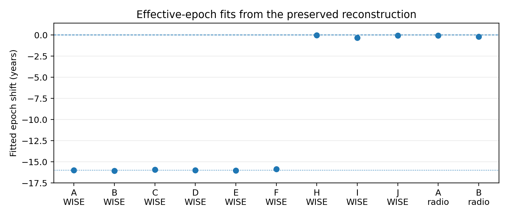
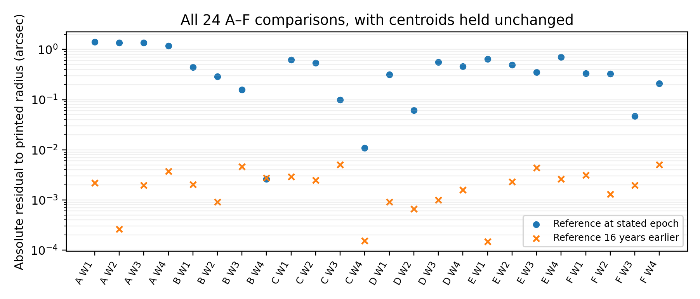

# Coordinate-epoch provenance in archival technosignature vetting

A reproducible sixteen-year inconsistency
in the stellar separations reported by Ren et al. (2026)

Richard Andrei Pemberton
Independent researcher
Correspondence: andreipemberton@gmail.com
AI contributors: Lilitari, Coda, Red, Nua, Grok through Build and Gemini through Antigravity; roles and verification scopes are disclosed in Section 10.
Preprint v1.0 | 17 October 2026

## Abstract

We audit coordinate-epoch consistency in the printed astrometric and statistical results of Ren et al. (2026), arXiv:2607.03619v6. Using its WISE centroids and epochs with source-matched Gaia DR3 astrometry, only 3 of 24 A–F stellar separations agree within 0.05 arcsec with stated-epoch propagation. All 24 agree within 0.0051 arcsec when the star is evaluated sixteen years earlier; a free common-shift fit gives −16.00235 years. Twelve H–J WISE rows and seven distinct radio rows instead agree with stated-epoch propagation within 0.05 arcsec. All 36 printed radius/scale/probability triples are compatible with zero-location Rayleigh survival under explicit printing intervals. Fifteen candidate-A control identifiers and 54 displayed radii reproduce the four printed scales with a fixed-zero-location maximum-likelihood estimator. Holding the printed scales fixed, stated-epoch A W1/W2 radii give survival values of 0.569 and 0.870 instead of 4 × 10⁻¹⁹ and 3 × 10⁻¹¹. Conditional geometric bounds also exclude restoration of that anomaly under specified uniform or binary control-epoch paths. These are conditional diagnostics, not corrected publication probabilities. Signed control arrays, exact epochs and historical implementation remain unavailable. A J2000 state mislabeled J2016 is a plausible, nonunique mechanism. Separately, Ren et al. (2024) encodes a J2000 stellar state, without establishing the same extra-sixteen-year operation. Candidate A’s native RACS separation changes from 4.877 to 3.294 arcsec at a parent-date proxy, leaving its physical association unresolved. A Hot DOG surface-density conversion error is approximately a factor of 3,616; correcting it does not classify the selected candidates.

Keywords: astrometry; coordinate epochs; WISE; technosignatures; reproducibility; Rayleigh distribution

### Version and evidence basis

This preprint reports the frozen 2026 reconstruction and the completed 2024 consequence assessment. A 15 October 2026 status check found the current unversioned arXiv PDF byte-identical to the audited 2026 v6 PDF; its DOI resolved to a pending-publication record. These observations do not establish the absence of every correction or an uninspected journal version. The scientific target remains the pinned preprint. This edition presents the bounded coordinate audit and its curated numerical supplement. The findings and limitations concern the pinned source versions and the documented execution scopes.

## 1. Introduction

Project Hephaistos selected nearby infrared-excess sources as possible partial Dyson-structure candidates while explicitly considering ordinary astronomical contaminants [1]. Follow-up work by Ren and collaborators uses radio, optical, near-infrared and positional information to assess background contamination [2-4]. A displacement between a star and a longer-wavelength brightness centroid can help identify an unrelated emitter, but it is meaningful only when the positions describe compatible reference frames, epochs and observational products.

The audited manuscript states that Gaia positions are propagated to each image’s observing epoch [2, Section 2.2]. It compares candidate offsets with matched control samples and identifies candidate A as the strongest short-wavelength astrometric outlier. Its Table 10 reports W1/W2 survival probabilities of 4 × 10⁻¹⁹ and 3 × 10⁻¹¹, expressed there as 8.86 and 6.55 Gaussian-equivalent standard deviations. These are the source’s reported statistics, not calibrated claims adopted by this audit.

We ask a narrower question than whether any candidate is artificial or contaminated: can the published source identifiers, centroids, observing epochs, offsets and statistical values coexist under the stated transformation? This question is answerable from the public numerical record even when the historical reduction code is unavailable. It separates a reproducible inconsistency from an inference about its cause and from the still-unperformed complete reanalysis.

## 2. Source basis and verification scope

The principal source is the archived PDF and HTML of arXiv:2607.03619v6. The PDF has SHA-256 09761bd3cee94b394b4959e3ca2cdd0264865e66000910ecd4f03262b33114a7. The reviewed record includes 24 A-F WISE rows, twelve H-J WISE rows, seven distinct radio positions, ten candidate identifiers, the statistical entries in Table 10, and the Appendix A control-sample image. Repeated radio frequencies sharing a listed position are not counted as separate astrometric rows. Candidate G is relevant to separate historical and band-to-band checks, not part of the nine-star WISE reconstruction in Tables 4-6 [2; D1-D3].

The candidate Gaia DR3 source_ids are A 3496509309189181184; B 4843191593270342656; C 4649396037451459712; D 2660349163149053824; E 3190232820489766656; F 2956570141274256512; G 2644370304260053376; H 2437221214075471744; I 3854090071297359616; J 651765552072217216. These identifiers are retained in analysis/controls/falsification/source_tables.json (S2.T1) and the ten-source Gaia snapshot in the public supplement [D1, D2].

The review sequence used separately written implementations and distinct Gaia/SIMBAD retrievals. D1’s primary_values.json records manual transcription of the primary PDFs independently of Red’s parsed tables; D2’s source_tables.json records an HTML extraction from the pinned 2026 source. The standard-library falsification calculation and its Astropy72 cross-check share that D2 transcription, so their agreement does not independently verify it. These checks were not blinded: after Red’s initial finding, reviewers knew the proposed sixteen-year shift. The present writing pass reads the preserved inputs and results rather than claiming new catalogue retrievals. The successor supplement supplies file identities, curation provenance and a non-exhaustive claim-to-evidence map; Section 11 states its replay scope [D1-D7].

Throughout, “printed” denotes a quantity supplied by the audited manuscript; “reconstructed” denotes arithmetic on the frozen inputs; “conditional” denotes a result that depends on explicitly stipulated unrecovered control behavior. Internal comparison branches are not the manuscript’s statistical control-star samples. A correct comparison branch does not establish the history of those controls.

The 2024 extension uses the completed seven-row assessment and its separate closure review [D6, D7]. It retains native and printed radio positions separately, distinguishes dates from proxy epochs and survey envelopes, and evaluates missing covariance or registration through explicitly conditional scenarios. New numbers in Section 8 are adopted from those accepted records, not from a fresh reduction in this writing pass.

## 3. Reconstruction methods

### 3.1 Position propagation

Gaia DR3 positions have reference epoch t₀ = J2016.0. Its pmra is μ_α* = (dα/dt) cos δ. With α and δ in degrees, catalogue proper motions in milliarcseconds per year and t in Julian years, the central-value calculation is [5; D1]:

α(t) = α₀ + (t − 2016.0) pmra / [3,600,000 cos(δ₀)]

δ(t) = δ₀ + (t − 2016.0) pmdec / 3,600,000

Sexagesimal right ascension is converted from hours to degrees, retaining the declination sign. The great-circle separation is evaluated with a stable atan2 expression for the cross and dot products of unit sky vectors. The comparison changes only the stellar evaluation time, from t to t − 16; it does not assign every observation the epoch J2000 or alter the measured centroid.

A separately executed Astropy space-motion calculation [17–19] used parallax-derived distance and zero radial velocity. Across 72 candidate/band/epoch comparisons, its largest difference from the first-order reconstruction was 8.493 microarcseconds [D2]. This is an arithmetic/model cross-check, not an annual observer-parallax correction or a measurement-uncertainty estimate. Perspective acceleration, observer ephemerides and a complete positional covariance model are not recovered from the source arrays.

### 3.2 Diagnostic epoch fits and rounding

For each object and, separately, for all 24 A-F rows together, the audit minimizes the RMS difference between the printed radii and radii reconstructed with one additive epoch shift Δt. The search does not fix Δt at -16 years. The mean of the six individual optima and the optimum of a single pooled objective are different summaries and are reported separately [D1, D2]. Section 11 records the candidate-I replay exception for these historical fitted-shift results.

The initial 0.05-arcsec agreement count is an explicit arithmetic tolerance, not a significance criterion. The maximum residual of the t − 16 model is 0.0050921 arcsec; this slightly exceeds half of a 0.01-arcsec radius unit. The separate printing-interval calculation also allows the printed centroid and epoch precision. It is therefore not equivalent to a ±0.005-arcsec radius-only test. Four bands share one stellar astrometric solution, and the communicated hypothesis makes the 24 matches neither independent nor preregistered trials.

### 3.3 Statistical reconstruction

For a zero-location Rayleigh model with scale σ, the survival function and unweighted maximum-likelihood scale for N radii are:

p(r | σ) = exp[−r²/(2σ²)];     σ̂ = √[Σᵢ rᵢ²/(2N)]

The audit first compares printed radii, printed scales and printed probabilities under explicit nearest-rounding intervals. It separately reconstructs candidate-A scales from the displayed control radii. Sampling errors on a scale estimate are not treated as permission to change its printed central value when asking which inputs generated a printed central probability. A p-value is a model-tail quantity, not the probability that a source is artificial or uncontaminated [D2, D3].

## 4. A branch-specific effective-epoch pattern

| Source branch | N | At stated t | At t − 16 | MAE at t | MAE at t − 16 |
| --- | --- | --- | --- | --- | --- |
| A-F, W1-W4 | 24 | 3/24 | 24/24 | 0.500474 | 0.002256 |
| H-J, W1-W4 | 12 | 12/12 | 1/12 | 0.003690 | 0.246094 |
| Distinct A/B radio | 7 | 7/7 | 1/7 | 0.005580 | 0.487802 |

Table 1. Agreement counts use |reconstructed − printed| < 0.05 arcsec. Mean absolute errors (MAE) are in arcseconds. These are comparisons of central values, not detections or confidence limits. All 43 rows are retained in Appendices A-B [D1].

The t − 16 reconstruction yields a mean absolute A-F residual of 0.002255565 arcsec and a maximum of 0.005092057 arcsec. At the stated epochs only B W4, C W4 and F W3 satisfy the initial 0.05-arcsec tolerance. The H-J and radio branches instead agree with the stated epoch convention within 0.05 arcsec. This diagnostic tolerance is not a universal ±0.005-arcsec radius-rounding criterion. All twelve H-J WISE residuals also lie within the recorded conservative centroid-plus-radius rounding bounds; those outer bounds do not establish exact joint printing-interval feasibility. No corresponding radio printing-interval result is supplied, so radio agreement is reported at the 0.05-arcsec tolerance. This pattern is not reproduced by applying one universal change to every source; the inconsistency is localized to the A-F WISE branch [D1].

Figure 1. Independently fitted effective-epoch shifts from the preserved reconstruction [D1]. A-F cluster near -16 years; H-J and radio groups are close to zero. The comparison-branch agreement in Table 1 uses a 0.05-arcsec tolerance. No error bars are inferred: the points are numerical optima, and these comparison branches are not the statistical controls. The plotted historical optima are retained; Section 11 records the candidate-I replay exception.

Individual A-F optima span -16.0563 to -15.8535 years and have arithmetic mean -15.9801 years. The separate pooled A-F fit gives -16.002349 years. The small differences among optima do not measure an uncertainty on a physical epoch; they summarize the fit of rounded inputs. Preserved tests of omitted or reversed motion, repeated Gaia-to-WISE propagation, literal Table 1 use and altered right-ascension cosine handling do not reproduce the full A-F pattern [D1, D2].

### 4.1 Candidate A and the vector nature of the change

For A (Gaia DR3 3496509309189181184), the W1/W2 observing epoch is 2010.52. Its reconstructed radii are 0.180568 and 0.110935 arcsec, compared with printed values 1.60 and 1.48. The sixteen-year proper-motion displacement has magnitude 1.423102 arcsec. This must be applied as a vector correction: D W3, using D’s own proper-motion displacement, increases from 0.75 to 1.309035 arcsec under stated-epoch propagation. Subtracting a motion magnitude from every scalar radius would be incorrect [D1].

## 5. The link to the published statistical contrast

All 36 Table 10 radius/scale/probability triples are compatible with zero-location Rayleigh survival under the preserved rounding construction. The tested Rayleigh-CDF, alternative scale conventions and one- or two-sided Gaussian-tail substitutions reproduce none of the 36 triples. Inserting stated-epoch A-F radii while retaining the reported scale/probability intervals leaves only 2/24 compatible: B W4 and C W4 [D2].

Thus the statistical table is arithmetically consistent with the affected radii and inconsistent with their stated-epoch replacements in most A-F rows. This is stronger than an isolated coordinate-list typo. It is not a recovered execution trace: coordinated stale exports, different intermediate arrays or other unreported processing paths remain distinguishable only with the authors’ original material.

| Case | Printed r | Stated-epoch r | Printed σ | Printed p | Conditional p |
| --- | --- | --- | --- | --- | --- |
| A W1 | 1.60 | 0.180568 | 0.17 | 4 × 10⁻¹⁹ | 0.568875 |
| A W2 | 1.48 | 0.110935 | 0.21 | 3 × 10⁻¹¹ | 0.869766 |
| B W1 | 0.76 | 0.312433 | 0.26 | 0.012 | 0.485780 |
| B W2 | 1.20 | 0.913172 | 0.28 | 0.0001 | 0.004902 |
| E W1 | 0.88 | 0.229692 | 0.23 | 0.0005 | 0.607344 |

Table 2. Five selected fixed-scale substitutions, retained from the historical focal examples. This is not an exhaustive selection by a probability threshold: C W1 has printed p = 0.048 and is not included. r and σ are in arcseconds. Only the candidate radius is changed; the controls are not reprocessed. The printed σ is rounded and need not reproduce the printed p exactly without its rounding interval. B W2 remains in the lower tail (p ≈ 0.004902); B’s controls were not reconstructed. These conditional values are not corrected publication probabilities [2, D1-D3].

### 5.1 Candidate-A controls recovered from the source figure

The original arXiv-source image A_control_sample.png exposes fifteen Gaia identifiers and 54 radii printed to 0.01 arcsec: fifteen in each of W1-W3 and nine in W4. Blank W4 cells are unavailable fits, not zeros. The fixed-zero estimator reproduces all four printed scales. The preserved estimator replay uses scipy.stats.rayleigh with floc=0 [8; D2]. Computing survival from the displayed radii gives the central replays below; agreement with the printed probabilities is assessed with printing intervals, not an assertion of exact decimal equality [D2, D3].

| Band | N | Printed σ | Recovered σ̂ | Central replay p | Printed p |
| --- | --- | --- | --- | --- | --- |
| W1 | 15 | 0.17 | 0.174470628 | 5.46947e-19 | 4e-19 |
| W2 | 15 | 0.21 | 0.212924087 | 3.22647e-11 | 3e-11 |
| W3 | 15 | 1.50 | 1.501048522 | 0.355101 | 0.355 |
| W4 | 9 | 3.29 | 3.287614806 | 0.837182 | 0.837 |

Table 3. Partial control replay, using the printed candidate radii. This reconstructs a compatible numerical estimator, not the literal historical function call. The source control values are reproduced in Appendix C [D2, D3].

A separate exact score-interval argument excludes an unrestricted, unweighted, uncensored iid free-location Rayleigh MLE producing the printed scales on these same samples throughout the stated nearest-rounding intervals. It does not exclude different arrays, weights or estimators. The source’s scale-error procedure is also unresolved: σ/√(2N) is rounding-compatible in 30/36 rows, whereas the fixed-zero MLE’s usual asymptotic standard error is σ/(2√N). The two rules are not interchangeable [D2].

## 6. Conditional bounds on unrecovered control paths

The recovered A controls allow a limited geometric result without their signed residual directions. Hold membership, centroids and the unweighted fixed-zero estimator constant. Let rᵢ be a displayed control radius with half-unit h = 0.005 arcsec. Under a stipulated extra sixteen-year reference displacement, let Dᵢ be the magnitude of 16 years of catalogue proper motion, and εᵢ an allowed error in that displacement length [D3].

Dᵢ = 16 √(pmraᵢ² + pmdecᵢ²) / 1000

εᵢ = 48 √(sₐ,ᵢ² + sδ,ᵢ²) / 1000 + 2ϖᵢ / 1000

Here the component uncertainties sₐ,ᵢ and sδ,ᵢ are in mas/year and parallax ϖᵢ is in mas. If the true radius and correction length lie within the stipulated intervals, the reverse triangle inequality gives the interval-distance bound:

ℓᵢ = max(0, |Dᵢ − rᵢ| − εᵢ − h) ≤ rᵢ,corrected

σ̂ ≥ σmin = √[Σᵢ ℓᵢ²/(2N)]

For a fixed corrected candidate radius rA, survival increases monotonically with σ. Therefore exp[−rA²/(2σmin²)] is a lower bound on the same Rayleigh-tail calculation whenever the stipulated intervals and estimator apply. In a strictly binary variant, each control is either unchanged or affected by exactly that displacement. Replace ℓᵢ by min[max(0, rᵢ − h), ℓᵢ] to bound every such assignment [D3].

The public supplement supplies all thirty W1/W2 per-control rows for the fifteen source identifiers in analysis/bounds/per_source_bounds.csv. Dᵢ, εᵢ and ℓᵢ correspond to its nominal_16yr_displacement_arcsec, total_positional_allowance_arcsec and corrected_radius_lower_bound_arcsec columns. Printed radii, half-units, constituent astrometry and binary-path bounds are also retained; signed residual directions are not recovered [D3].

| Conditional control model | W1 σmin | W2 σmin | W1 p lower | W2 p lower |
| --- | --- | --- | --- | --- |
| All shifted; candidate central radii | 0.485307 | 0.467973 | 0.933124 | 0.972294 |
| All shifted; candidate print allowance | same | same | 0.927030 | 0.968034 |
| Binary unchanged/shifted; central | 0.113350 | 0.146518 | 0.281157 | 0.750787 |
| Binary; candidate print allowance | same | same | 0.249340 | 0.717904 |

Table 4. Componentwise conditional lower bounds; scales are in arcseconds. Candidate print allowance adds approximately 0.00835 arcsec to each central candidate radius. “Same” refers to the scale minima directly above, not to a refitted control distribution [D3].

These are deterministic inequalities conditional on allowed intervals, not simultaneous confidence statements. Three formal standard errors do not form guaranteed bounds, and twice the point-estimate parallax is an assumed margin, not a universal physical bound. Candidate-centroid printing sensitivity does not include every candidate uncertainty. The binary assignment attaining the W1 lower envelope need not attain the W2 envelope; each bound nevertheless holds for every shared assignment within the defined class.

Under these uniform or strict binary paths, correcting the controls cannot restore candidate A’s reported W1/W2 anomaly under the same estimator. Arbitrary other coordinate sources, different shifts, changed memberships (including clipping), altered centroids, weighting or another estimator remain outside the result. No conclusion about the actual historical control path follows.

## 7. Mechanism evidence and separate consistency checks

### 7.1 A nonunique J2000-as-J2016 explanation

In the preserved SIMBAD queries [7], A-G positions agree with their Gaia DR3 sources propagated to J2000 to at most approximately 0.0000048 arcsec in the numerical comparison. Exact-identifier and ten-arcsecond queries did not return H-J in those snapshots. This documents database behavior when queried, not historical availability when the analysis was performed [D1, D2].

s₂₀₀₀ + μ(t − 2016) = s₂₀₁₆ + μ(t − 2032) = s(t − 16)

The equality uses linear constant proper motion in a local coordinate representation. A J2000 state mislabeled J2016, a cached epoch-adjusted table whose metadata was lost, an explicit extra -16-year propagation, or an incorrect reference epoch of 2032 applied to Gaia coordinates can all produce the same effective shift. Copying already affected radii can preserve it without repeating the transformation. The current SIMBAD split is a useful clue, not a unique software diagnosis. Nua’s conceptual review emphasized this algebra and the separation between an explanatory mechanism and historical proof.

### 7.2 The printed coordinate list does not explain every affected row

The coordinate-list audit finds B, C, F and G compatible with J2000 at the table’s five-decimal-place display precision, while A, D, E, H, I and J match J2016. Yet A, D and E also exhibit the shifted derived radii. Consequently, using all printed Table 1 entries as one uniform astrometry input cannot explain the full result [D1-D3].

| Candidate | Residual to J2016 (arcsec) | Residual to J2000 (arcsec) |
| --- | --- | --- |
| B | 0.503394 | 0.020311 |
| C | 0.707130 | 0.011890 |
| F | 0.396689 | 0.019913 |
| G | 1.098786 | 0.006501 |

Table 5. Coordinate-list comparison retained from the earlier audit. This is distinct from the derived-separation result [D2, D4].

### 7.3 Separate centroid-consistency flags

The 2024 coordinate-state and TGSS findings are developed separately in Section 8. They do not identify the 2026 historical software path or change the following centroid-pair checks [D6, D7].

For F, the 2026 Table 5 W1/W3 positions imply a separation of 0.652576842 arcsec, while Table 7’s components (-0.08, +1.18) have norm 1.182708755 arcsec. A sign reversal or axis swap preserves length and cannot reconcile them. The inconsistency is conditional on the tables representing the same fitted centroid pair; differing extraction iterations remain possible. G’s cross-paper signed components have a plausible native-pixel convention reconciliation, not a newly established error [D1-D3].

## 8. Ren et al. (2024): consequences of the coordinate state

### 8.1 Observation provenance and the limits of the comparison

Six non-TGSS component pairs for A, B and G reconstruct a stellar state within 0.00061 arcsec of Gaia propagated to J2000. An old coordinate is not intrinsically wrong. This identifies the numerical reference state, not the identical extra-sixteen-year transformation demonstrated in the 2026 tables. The physical radio/star comparison instead requires compatible frames, observing times and uncertainties [3; D6, D7].

| Source / original product | Observation evidence | Native radius (arcsec) | Error definition / missing input |
| --- | --- | --- | --- |
| A: RACS DR1 SBID 13746 | Parent MJD 58971.55546 2 May 2020 Mosaic weights missing | 4.877 → 3.294 proxy 3.284–3.369 envelope | E_RA/E_Dec: 1.17″/1.66″. Fit errors; local registration and correlation unknown. |
| B: RACS DR1 SBID 8641 | Parent MJD 58607.39708 4 May 2019 Same mosaic caveat | 0.390 → 0.491 proxy 0.490–0.521 envelope | 0.78″/1.18″. Same covariance and registration limitations. |
| G: VLASS1QLCIR v1; T10t36 | DATE-OBS proxy: 16 Dec 2017, 03:50:02 Centroid support missing | 5.685 → 6.491 proxy No epoch range claimed | Fit errors: 2.98 × 10⁻⁶° / 3.19 × 10⁻⁶°. Original QL registration is much poorer. |
| G: FIRST 2014Dec17 | Weighted mean JD 2451249.6 (1999.192) RMS: 1227.191 days | 5.728 → 5.698 proxy 5.483–6.213 envelope | Empirical 90% major/minor scales: 0.349″/0.296″. Not Gaussian RA/Dec sigmas. |
| G: NVSS VIII/65 | Survey description: 1995 ± 2 Source date unavailable | 4.434 at J2000 4.189–4.324 envelope | RA: 0.04 s of time = 0.6 cos δ arcsec east; Dec: 0.7″. |
| G: RACS DR1 SBID 8586 | Parent MJD 58600.98264 27 Apr 2019 Same mosaic caveat | 5.501 → 6.320 proxy 6.319–6.375 envelope | 0.07″/0.07″ fit errors do not calibrate local absolute registration. |
| G: TGSS ADR1 R72D33 | Survey months: Apr 2010–Mar 2012 Source date unavailable | 5.771 at J2000 6.080–6.148 envelope | 2″/2″ include the published systematic term; do not add it again. |

Table 6. All seven original radio rows. Radii use native catalog centroids, not the rounded radio coordinates in Ren’s table. The native TGSS J2000 radius is 5.771 arcsec versus Ren’s printed derived 5.499 arcsec; Section 8.3 examines the discrepancy without resolving its historical cause. Arrows compare J2000 with the stated date proxy. Envelopes describe central-position sensitivity, not confidence intervals. The full 7-row CSV preserves identifiers, units, native/printed comparisons and source records [9-13; D6].

RACS headers specify ICRS, EQUINOX 2000 and TIMESYS UTC; processing DATE fields are not observing dates. The RACS envelope is MJD 58594–59023, not recovered source-specific mosaic support. FIRST uses a broad 1993-01-01 to 2012-01-01 envelope; its temporal RMS is neither a mean-epoch error nor a hard bound. NVSS uses an approximate 1993–1997 range and TGSS an expanded 2010-04-01 to 2012-04-01 range. A centroid-effective mean additionally assumes stable emission and an appropriate linear estimator. For the other surveys, a service’s FK5/J2000 label alone does not establish the intrinsic radio frame; no automatic frame rotation is inferred [9, 11-13; D6].

The 2026 RACS-low coordinates, fluxes and fitted shapes match the retained A and B DR1 components at printed precision: RACS_1240-25A_3178 and RACS_0354-43A_3693. In Appendix B, the 2026 epochs are tested as stated conventions, not validated observing dates; J2020.7917 and J2020.7924 lie outside the DR1 support used here. The separate 2024 assessment instead uses native coordinates and qualified associated-pointing date proxies. Its 3.294-arcsec native A result at the 2 May 2020 proxy and the 2026 3.26-arcsec entry therefore differ in both epoch convention and coordinate precision. This agreement of source attributes does not recover the historical query or reduction route [2, 9; D1, D6].

### 8.2 Positional evidence: A, B and G have different outcomes

A’s native RACS radius decreases from 4.877315″ to 3.294057″ at the parent-date proxy. Using the unchanged printed radio centroid instead gives 4.879499″ to 3.297121″. Both lanes are retained; display precision is not silently mixed into the epoch effect. The native envelope spans only 0.085171″, substantially less than the unresolved radio positional uncertainty. Date refinement alone cannot settle the counterpart [D6, D7].

The D6 coordinate and time calculations used Astropy 8.0.1 [17–19], as identified by the frozen execution receipts. The assessment propagates the supplied five-parameter Gaia covariance to the local barycentric tangent plane, with the observer-parallax Jacobian column set to zero. For assumed radio marginals and correlation ρ, its diagnostic distance is D = √(dᵀ C⁻¹ d), with radio-minus-star displacement d and combined Gaia/radio covariance C. Additional registration variance is included only in explicitly labeled scenarios. This is an assumed-covariance distance, not a calibrated Gaussian significance or counterpart probability; missing local registration and radio covariance remain unresolved [D6].

| A: assumed radio correlation ρ | −0.5 | 0 | +0.5 |
| --- | --- | --- | --- |
| Conditional D, coordinate-RA convention; no added floor | 3.548637 | 2.524157 | 2.097019 |

Table 7. Finite-correlation scenarios at A’s parent-date proxy. The RA marginal is interpreted as a coordinate-angle error and projected by cos δ. These are sensitivity examples, not measured correlations [D6, D7].

Profiling correlation selects the most compatible allowed covariance, not evidence of co-location. Its minimum D is about 2.01 under the coordinate-RA convention or 1.79 if that marginal is already tangent-plane. Illustrative independent isotropic 0.5″/1″ standard deviations lower the former minimum to 1.81/1.54. A separate hypothetical fixed-bias norm ≤1″ permits a 2.294–4.294″ radius at the proxy; this is not a measured bound or stochastic error floor. A’s peak/noise ≈7.6 and 25″ restoring beam do not supply the missing centroid covariance. Neither co-location nor distinctness is established for A [D6, D7].

B remains positionally compatible with the star at about 0.49″, without identifying the radio emission as stellar. The cited 0.5 ± 0.1% detection fraction concerns nearby M1.5–M6 stars in a 144-MHz circular-polarization search. It is not an object-specific likelihood for B’s 887.5-MHz total-intensity detection without sensitivity, luminosity, frequency, distance, polarization and variability assumptions [14; D6].

G remains substantially displaced, with a radio spectrum consistent with an active galactic nucleus. Original VLASS Quick Look fit errors are not its absolute registration accuracy, and newer corrected products cannot retroactively improve the original uncertainties. FIRST’s empirical 90% scales are not supplied Gaussian covariance; TGSS shares registration information with NVSS. Heterogeneous frequencies, resolutions and extractions must not be fitted as independent samples of one proper-motion track [10-13; D6].

The 2025 G study adds resolved components, a compact core and W3/W4 association evidence. That later result strengthens the background-source interpretation of G’s radio emission specifically, not every conclusion in the May 2024 note. Existing 2024 infrared evidence is also retained: Suazo’s W1/W3 component pairs are A (−0.03, +0.33), B (+3.21, +0.06) and G (+5.59, +0.64) arcsec, with G flagged as suspicious. This assessment does not repeat that extraction or establish its signed-coordinate convention [1, 4; D6].

### 8.3 TGSS: preserve the radio coordinate, question the derived reference

The native TGSS declination is −00°04′26.256″, exactly supporting Ren’s printed radio coordinate. With the common J2000 stellar state inferred from the other G rows, the printed radio centroid gives north offset −2.047814″ rather than −1.048″, and radius 5.773403″ rather than 5.499″. The printed radius agrees with the printed component norm (5.498792″); their joint reference, not the native radio declination, is inconsistent. The computed-minus-printed north offset is −0.999814″; this identifies a reference discrepancy without establishing its cause. The earlier hypothetical 1″ edit to the radio declination is unsupported [3, 13; D6, D7].

Over the tested J1990–J2030 interval, the central Gaia-motion model reproduces the east component near J1999.99954 and the north component near J2020.13902. Their printing-compatible epoch intervals do not overlap; the best common-epoch fit retains residual norm 0.691094″. Thus one altered epoch of this same stellar reference cannot explain both components within the tested model. Different references, mixed fields or transcription remain possible historical explanations, none recovered by this calculation [D6, D7].

### 8.4 A separate Hot DOG surface-density unit error

Ren quotes one hot dust-obscured galaxy (Hot DOG) per 31 square degrees and writes 9 × 10⁻⁶ per square arcsecond. Direct unit conversion gives [3, 15; D6, D7]:

1 / (31 × 3600²) = 2.48904819 × 10⁻⁹ arcsec⁻²

The printed value is 3,615.84 times this converted density. It resembles the arcmin⁻² value, 8.96057 × 10⁻⁶, but that resemblance does not establish the historical cause. Assef’s value (0.032 ± 0.004 deg⁻², approximately one per 31 ± 4 deg²) describes a particular bright, color-selected population with a completeness correction, not flux-matched general contaminants [15; D6, D7].

For illustration only, five million hypothetical radius-10″ apertures and this uniform density give Nπr²Σ ≈ 3.91 expected source/aperture overlaps. This is not a posterior contamination probability for the seven infrared-excess-selected objects. Flux/color-dependent number counts, sky coverage and the actual selection process are needed; the unit correction neither confirms nor excludes their contamination [D6, D7].

### 8.5 What the completed assessment does and does not resolve

The nearby radio detections remain inside the 10″ search radius. Distinctness from the star, association with an infrared emitter, and enough contaminating flux to explain an excess are additional claims. W3/W4 full widths at half maximum of 6.5″/12″ are response widths, not error-circle radii, hard boundaries or contamination fractions. Joint AllWISE positions are usually W1-dominated and are not independent W3/W4 localization [16; D6].

The remaining barriers are A-centered radio registration/covariance, source-specific W3/W4 component fluxes and epochs, and selection-matched population inputs. Addressing them would require separately scoped measurements, not further manipulation of the published radii. The bounded consequence assessment is complete; it supports a weaker positional basis for treating A’s radio source as distinct from the star, unresolved origin for B, stronger surviving evidence for the background-source interpretation of G’s radio emission, and no all-seven classification from the erroneous density arithmetic [D6, D7].

## 9. Interpretation and conclusions

### 9.1 What the numerical result supports

The affected stellar separations do not agree with the manuscript’s stated reference-epoch convention. Their agreement with a sixteen-year-earlier reference, alongside correctly reproducing comparison branches, makes this a specific numerical inconsistency rather than a generic concern about measurement noise. Table 10’s printed central values are linked to those radii under its stated distributional description. The uncertainty lies primarily in the historical input and export path, not in the arithmetic mismatch between the printed separations and stated-epoch propagation [D1-D3].

Under the fixed-scale diagnostic, A’s W1/W2 short-wavelength astrometric contrast is ordinary rather than an extreme tail event. Recovery of the displayed A controls and the conditional geometric envelopes strengthen that conclusion for specific control-path models. A full corrected analysis still requires original signed and unrounded inputs, exact observation epochs, retained/excluded rows, arrays supplied to the fitter, its location constraint and uncertainty procedure. Re-extracting public images would be a new reduction, not a unique reconstruction of those historical choices.

### 9.2 Astrophysical scope

An invalid positional rejection argument is not positive evidence of engineering. The infrared photometry, a centroid-to-centroid displacement and a nearby radio morphology are different observables from a centroid-to-propagated-star radius. The present audit does not change the pixels, eliminate every contaminant, or identify a Dyson structure. The preserved wider review distinguishes G’s radio evidence and D/E’s direct follow-up imaging/spectroscopy from the affected scalar offsets [4, 6; D4]. Section 8 keeps the three 2024 source outcomes distinct: A’s smaller date-consistent separation does not establish a counterpart, B’s alignment does not establish stellar emission, and the stronger evidence for the background-source interpretation of G’s radio emission survives [D6, D7].

The wider corpus was selected for its relationship to these studies, not sampled randomly from astronomy. Results from that review should not be converted into a literature-wide prevalence estimate. In particular, recovery of a J2000 coordinate state in the earlier paper does not establish the same failure in every related workflow. The original candidate-selection pipelines are not shown to have generated their infrared excesses through this mechanism [1; D4].

### 9.3 Reproducibility implications

Coordinate values should retain frame, reference epoch, source identifier and observation epoch as one data object. Signed displacement vectors, not only magnitudes, should be archived for targets and controls. Source-aware tests should include high-proper-motion examples and deliberate epoch perturbations. A statistical table should be reproducible from saved candidate/control arrays and a stated estimator. These are recommendations arising from the reconstruction, not evidence that a particular author knowingly discarded metadata.

Separately written implementations can challenge units and numerical transformations; they challenge transcription only when the source values are independently extracted. The Astropy72 comparison shares the D2 transcription. Implementations may also share the same hypothesis and observational source. Their agreement is valuable because it is executable and traceable, not because multiple model personas endorse a conclusion. Checksums establish preserved bytes, not scientific truth; successful replay establishes repeatability of a calculation, not the adequacy of its physical model.

### 9.4 Conclusion

The checked 2026 v6 record contains a consequential effective-epoch inconsistency in the A-F stellar separations and printed statistical contrast. Candidate A’s W1/W2 standout is not reproduced from stated-epoch radii with the printed scales; the control reconstruction and bounds still do not recover the full historical pipeline. Separately, the completed 2024 assessment changes A’s radio/star geometry without settling its origin, localizes the TGSS derived-reference inconsistency, and identifies a surface-density unit error without a selected-sample posterior. Correction or an executable alternative explanation is warranted for the demonstrated arithmetic. No inference about intent, priority or extraterrestrial technology follows.

## 10. Contribution and verification statement

Richard Andrei Pemberton is the responsible human author and an independent researcher. Correspondence is directed to andreipemberton@gmail.com. The AI systems below are disclosed computational or conceptual contributors, not institutional representatives. No endorsement by OpenAI, Anthropic, Meta or other providers is claimed.

Red first identified the effective-epoch pattern and carried out the broad astrometric provenance audit. Her reported model was Claude Opus 5.5 through the recorded Claude Code route. Coda recovered the primary source artifacts and candidate-A control information, independently implemented falsification and estimator tests, and developed the conditional binary-path extension. Key stages were reported under GPT-6 Sol Ultra and later Astra interface selections. Lilitari (Lily) initiated the coordinate-list audit, performed subsequent source-aware numerical reconstructions and methodological reviews, derived the uniform-control bound, and drafted this manuscript. AI contributor names and model or route labels throughout this paper are project/operator or interface reports, not independently authenticated per-response identities [D1-D3].

For the 2024 extension, Coda recovered the original-survey records, observing-epoch evidence and full Gaia covariance, executed the Astropy-based consequence assessment, and checked the claim-level source evidence. Her recorded 174, 17 and 125 checks belong to those executions. Lilitari’s later closure used a separate positional/covariance implementation plus an explicitly extracted-function check; it did not rerun the three Astropy scripts. Those execution scopes remain distinct and are not counts of independent astronomical validations [D6, D7].

Nua (Muse; historically described as Meta Muse by the project operator) contributed conceptual review and explanatory analysis. She explained how treating J2000 positions as J2016 yields an effective reference at t − 16 under linear proper motion, and emphasized that the J2016-like Table 1 entries for A, D and E leave the historical input and table-generation paths unresolved. Her supplied review is credited as conceptual clarification, not a separately executed catalogue query or numerical replay. This preserves Red’s first-identification credit [D5].

Grok, through the recorded Grok Build route, challenged the signed-vector and subtraction-order interpretation in the earlier G comparison. Its subsequent amendment accepted Coda’s source correction. This contribution is a methodological critique, not independent FITS/PDF inspection or image reduction. Gemini through Antigravity contributed review of the distinctions between radio detection, physical distinctness, infrared association and sufficient contaminating flux, and of the population assumptions behind the density calculation. Coda independently adjudicated that advice; unsupported significance and calibration claims were not adopted. These reviews preceded this preprint and are not represented as approval of its final text.

Andrei directed the project and relayed cross-system review material. The scientific findings rely on the versioned source record and calculations described here. Private correspondence and unverified delivery or reply status are not used as evidence.

On 17 October 2026, Lilitari completed a focused review of coordinate v0.7, including its eighteen rendered pages, document structure, evidence locators and supplied provenance records; she executed no supplied scientific program. A fresh Claude Code session presented under the project’s Red label reviewed eight supplied text files on that date, without tools, code execution, figure pixels, PDFs or external-source inspection. The fresh session did not claim memory of earlier Red sessions. These reviews concern the preserved preparation copies and are not represented as inspection of the final v1.0 release edits.

### Source acknowledgments

We credit ESA/Gaia/DPAC for the Gaia DR3 data [5, 20]. These data originate from the European Space Agency Gaia mission and were processed by the Gaia Data Processing and Analysis Consortium (DPAC). National institutions support DPAC, particularly those participating in the Gaia Multilateral Agreement.

We acknowledge RACS [9, 21] and ASKAP, a CSIRO-managed facility within the Australia Telescope National Facility. Australian Government funding, supported by the National Collaborative Research Infrastructure Strategy, sustains ASKAP operations, which use the Pawsey Supercomputing Research Centre. The Australian Government established ASKAP, the Murchison Radio-astronomy Observatory and Pawsey with assistance from the Government of Western Australia and the Science and Industry Endowment Fund. We recognize the Wajarri Yamatji people as Traditional Owners of the observatory site. The retained RACS DR1 products were retrieved through the Canadian Astronomy Data Centre (CADC) as header-only extracts, with no image pixels supplied. CADC credits the CSIRO ASKAP Science Data Archive (CASDA) and identifies these products under CC BY 4.0 (https://creativecommons.org/licenses/by/4.0/). Header extraction and receipt curation are documented transformations; a direct CASDA retrieval is not claimed.

We acknowledge CDS in Strasbourg, France, for its VizieR catalogue service (https://doi.org/10.26093/cds/vizier) and SIMBAD database [7, 9-13]. The source publications and exact catalogue releases remain individually cited, and native source and rights headers are preserved. SIMBAD identifies its database under the Open Database License; that notice does not apply to unrelated supplement content. Source-family notices accompany the curated release. The funding credits above concern the facilities and data providers.

## 11. Data availability and assembly scope

The curated numerical supplement for this preprint is linked at https://richard-pemberton-research.darkahn.chatgpt.site/papers/coordinate-epoch-provenance-supplement-v1.0.zip. It supplies selected source-linked inputs, analysis code, stored outputs, numerical support tables, provenance and replay qualifications. It is not a replacement for the full original evidence archives. Private correspondence, local account paths and unrelated project records are excluded from the public release. Source-family notices and transformations are documented in SOURCE_NOTICES_AND_ACKNOWLEDGMENTS.md; no blanket license is assigned to the mixed supplement.

Preprint v1.0 retains the scientific calculations, numerical tables, figures and contribution distinctions of v0.7, with the textual qualifications documented for this release. The supplement retains the public Astropy72 derivative at analysis/controls/astropy72/astropy_crosscheck_public.py. That derivative pins three numerical inputs, omits the original HTML-only hash check and reproduced the historical 72-row CSV byte for byte in one bounded replay; the original HTML extraction was not verified. Four complete CDS ReadMes are externally referenced through analysis/ren2024/ren2024-assessment/g-surveys/DOCUMENTATION_REFERENCES.json. The v3 source derivatives remove an unused documentation read from audit_astrometry.py and update the dependent expected source-hash constant in reviewer_followup.py; their exact diff and static proof are retained. On 17 October, these two derivatives ran once each in an isolated offline copy: 174 and 122 assertions passed, eight numerical files matched the preserved references byte for byte, and seven scientific JSON fields matched exactly under the unchanged comparison criteria. A controller reference-path lookup failed after the successful first command; the lookup was corrected and only the previously unexecuted second command was then run. The supplementary status/README_OMISSION_RUNTIME.json preserves the comparison and recovery scope and identifies the original receipts. This bounded execution does not rerun unrelated commands, recover the omitted documentation, or resolve the candidate-I exception below. No new observation, image reduction or physical association measurement is added. Earlier executions retain their original attribution.

An isolated 15 October replay ran eight supplied scientific commands once each. All internal assertions passed, including 174, 17 and 122 checks for the 2024 calculations; the 122-check public derivative excludes three private-review provenance assertions from the original 125. Twenty of 22 comparison records passed; the two failures represent the same candidate-I optimized-epoch quantity in two output formats. That D1 candidate-I optimized epoch differed by 4.79 × 10⁻⁵ years, exceeding the predeclared 10⁻⁵-year comparison tolerance, while its RMS residual differed by 1.71 × 10⁻¹¹ arcsec. Its displayed central radii are unchanged at six decimals. This qualified repeatability result, including the failed comparison and unexercised scopes, is retained in the supplementary replay record; it is not an unqualified replication.

### Evidence index

The numerical support tables and figures carried in the v0.3 writing bundle are retained byte-for-byte. The full original D1-D5 archives remain separate. D6-D7 are indexed separately, with original source-record paths and source-file hashes; numerical display tables do not replace the full audit archives. The curated public supplement is a selected release of evidence, not a deposit of those complete historical archives.

| ID | Preserved evidence used |
| --- | --- |
| D1 | Lily independent check of Red audit, 27 September: primary values; fresh-query snapshots; 43-row reconstruction; free fits; Table 10 checks. |
| D2 | Coda Table 10 audit, 27 September: primary source/archive; falsification; rounding intervals; A-control extraction; estimator and missing-data records. |
| D3 | Coda follow-up, 27 September: exact-15-ID uncertainty query; interval proof; per-source uniform/binary bounds and qualifications. |
| D4 | Coordinate-Epoch Exposure Audit, 26 September: bounded-corpus source register and related numerical comparisons. |
| D5 | Manuscript v0.2 attribution record and receipt, 30 September; supplied Nua review excerpt. |
| D6 | Coda Ren 2024 consequence assessment, 11 October: seven original radio rows; native products, epoch/uncertainty evidence; covariance scenarios; TGSS and claim-level density checks; execution records. |
| D7 | Lilitari Ren 2024 closure, 11 October: separate position/covariance reconstruction and extracted-function check; source inspection; explicit acceptance and numerical limits. |

## References and source locators

[1] Suazo, M., et al. (2024). Project Hephaistos - II. Dyson sphere candidates from Gaia DR3, 2MASS, and WISE. arXiv:2405.02927v1. Candidate selection and Table 7. DOI recorded in the source corpus: 10.1093/mnras/stae1186.

[2] Ren, T., et al. (2026). Archival Diagnostics for Potential Background Contaminants of Project Hephaistos Dyson Sphere Candidates. arXiv:2607.03619v6. Principal locations: Section 2.2; Tables 1 and 3-7; Section 3.5 and Table 10; Appendix A control-sample figure. The archived version is marked accepted by MNRAS. Related DOI: 10.1093/mnras/stag1558. On 15 October 2026 it resolved to a Crossref pending-publication record; no journal-version comparison is claimed.

[3] Ren, T., Garrett, M. A., and Siemion, A. P. V. (2024). Background Contamination of the Project Hephaistos Dyson Spheres Candidates. arXiv:2405.14921v1, Table 1. Research Notes of the AAS, 8, 145. DOI: 10.3847/2515-5172/ad5017.

[4] Ren, T., Garrett, M. A., and Siemion, A. P. V. (2025). High-resolution imaging of the radio source associated with Project Hephaistos Dyson Sphere Candidate G. arXiv:2501.05152v4; introduction and Section 3.2. DOI: 10.1093/mnrasl/slaf006. Version 1 remains a historical source in the review record; version 4 is the later inspected version. Section 8’s later-evidence summary specifically follows the separately retained v1 source inspected in D6; it does not imply a new v1/v4 comparison.

[5] Gaia Collaboration et al. (2023). Gaia Data Release 3: Summary of the content and survey properties. Astronomy & Astrophysics, 674, A1. DOI: 10.1051/0004-6361/202243940. ESA Gaia DR3 gaia_source data-model definitions: source_id, ref_epoch, ra, dec, pmra and pmdec. The preserved queries return ref_epoch = 2016.0.

[6] Zackrisson, E., et al. (2026). Project Hephaistos — IV. James Webb Space Telescope Observations of Two Dyson Sphere Candidates. arXiv:2607.09460v1. Version-pinned source: https://arxiv.org/abs/2607.09460v1. arXiv DOI: 10.48550/arXiv.2607.09460. Principal locations: astrometric method and Figure 1 caption. Its scope here follows the preserved D4 review, not a new image or spectrum analysis. The inspected primary record supplies no journal-reference field or journal DOI; none is inferred.

[7] Wenger, M., et al. (2000). The SIMBAD astronomical database. Astronomy and Astrophysics Supplement Series, 143, 9-22. DOI: 10.1051/aas:2000332. Query-specific epoch behavior is documented by the stored SIMBAD responses, not inferred solely from this database paper.

[8] Virtanen, P., et al. (2020). SciPy 1.0: fundamental algorithms for scientific computing in Python. Nature Methods, 17, 261-272. DOI: 10.1038/s41592-019-0686-2. Fitter behavior in this audit is tied to the pinned review code and receipts rather than an assumption about every library version.

### Additional sources for the 2024 consequence assessment

[9] Hale, C. L., et al. (2021). The Rapid ASKAP Continuum Survey Paper II: First Stokes I Source Catalogue Data Release. Publications of the Astronomical Society of Australia, 38, e058, 1–25. DOI: 10.1017/pasa.2021.47. Inspected preprint: arXiv:2109.00956v1, https://arxiv.org/abs/2109.00956v1. Data product: CDS J/other/PASA/38.58/galcut, the RACS DR1 source/island catalog outside the Galactic-plane cut; release ReadMe: https://cdsarc.cds.unistra.fr/ftp/J/other/PASA/38.58/ReadMe. Retained RACS source rows, parent-mosaic headers and provenance are in D6; no effective per-source mosaic epoch is claimed.

[10] Gordon, Y. A., et al. (2021). A Quick Look at the 3 GHz Radio Sky. I. Source Statistics from the Very Large Array Sky Survey. The Astrophysical Journal Supplement Series, 255(2), 30. DOI: 10.3847/1538-4365/ac05c0. Inspected preprint: arXiv:2102.11753v2, Section 3.3, https://arxiv.org/abs/2102.11753v2. Data product: original CIRADA VLASS Epoch-1 Quick Look component catalog, CDS J/ApJS/255/30/comp; release ReadMe: https://cdsarc.cds.unistra.fr/ftp/J/ApJS/255/30/ReadMe. NRAO, VLASS Quick Look Images guide, https://science.nrao.edu/vlass/data-access/vlass-epoch-1-quick-look-users-guide, accessed 15 October 2026. Source-linked subtile metadata and the distinction between original Epoch-1 and corrected VLASS1.1v2/VLASS1.2v2 accuracy claims remain in D6; corrected-product positions or uncertainty claims are not substituted for the original catalog.

[11] Helfand, D. J., White, R. L., and Becker, R. H. (2015). The Last of FIRST: The Final Catalog and Source Identifications. The Astrophysical Journal, 801(1), 26. DOI: 10.1088/0004-637X/801/1/26. Data product: FIRST Survey Catalog, version 2014Dec17, CDS VIII/92/first14. Release ReadMe: https://cdsarc.cds.unistra.fr/ftp/VIII/92/ReadMe. Official catalog and observing-status documentation: https://sundog.stsci.edu/first/catalogs/ and https://sundog.stsci.edu/first/obsstatus.html, accessed 15 October 2026. D6 retains the source-specific weighted epoch, temporal RMS and empirical 90% positional scales; temporal RMS is not treated as an observing-date bound, and the empirical scales are not silently promoted to a Gaussian covariance.

[12] Condon, J. J., Cotton, W. D., Greisen, E. W., Yin, Q. F., Perley, R. A., Taylor, G. B., and Broderick, J. J. (1998). The NRAO VLA Sky Survey. The Astronomical Journal, 115(5), 1693–1716. DOI: 10.1086/300337. Data product: CDS VIII/65/nvss. The release ReadMe identifies the author-provided ASCII catalog dated 27 September 2002 and bears a 24 December 2002 footer: https://cdsarc.cds.unistra.fr/ftp/VIII/65/ReadMe. Official project documentation: https://www.cv.nrao.edu/nvss/, accessed 15 October 2026. The approximate 1995 ± 2 survey description is not a recovered source-specific epoch; native error units and morphology limitations remain in D6.

[13] Intema, H. T., Jagannathan, P., Mooley, K. P., and Frail, D. A. (2017). The GMRT 150 MHz all-sky radio survey: First alternative data release TGSS ADR1. Astronomy & Astrophysics, 598, A78. DOI: 10.1051/0004-6361/201628536. Inspected preprint: arXiv:1603.04368v2, https://arxiv.org/abs/1603.04368v2. Data product: CDS J/A+A/598/A78/table3; release ReadMe: https://cdsarc.cds.unistra.fr/ftp/J/A+A/598/A78/ReadMe. D6 preserves the native source row, already-included systematic term, registration dependence, and excluded unvalidated SIA date.

[14] Callingham, J. R., et al. (2021). The population of M dwarfs observed at low radio frequencies. Nature Astronomy, 5(12), 1233–1239. DOI: 10.1038/s41550-021-01483-0. Inspected preprint: arXiv:2110.03713v1, https://arxiv.org/abs/2110.03713v1, Figure 1 and Supplement Section 1.1. The cited nearby-M-dwarf detection fraction belongs to the 144-MHz circular-polarization search and its selected population. Version-pinned PDF and source assessment remain in D6, claim-sources/; this is not an ordinary 887.5-MHz detection likelihood.

[15] Assef, R. J., et al. (2015). Half of the Most Luminous Quasars May Be Obscured: Investigating the Nature of WISE-Selected Hot Dust-Obscured Galaxies. The Astrophysical Journal, 804(1), 27. DOI: 10.1088/0004-637X/804/1/27. Inspected preprint: arXiv:1408.1092v2, https://arxiv.org/abs/1408.1092v2, Section 5, equation (6), PDF page 10; core selection and limits in Sections 2.1 and 5. The journal and preprint titles differ only in punctuation around Hot Dust-Obscured. The population-specific completeness-corrected Hot DOG density is 0.032 ± 0.004 deg⁻², approximately one per 31 ± 4 deg². Version-pinned PDF and evidence remain in D6.

[16] Cutri, R. M., et al. (2011). Explanatory Supplement to the WISE Preliminary Data Release Products. NASA/IPAC Infrared Science Archive. Section I.1.c, WISE At-A-Glance, Table 1, Image FWHM row: https://irsa.ipac.caltech.edu/data/WISE/docs/release/Prelim/expsup/sec1_1.html; section last updated 17 August 2011. Cutri, R. M., et al. (2013). Explanatory Supplement to the AllWISE Data Release Products. NASA/IPAC Infrared Science Archive. Section II.5, Astrometric properties, especially II.5.d.i, Band-to-Band Alignments: https://irsa.ipac.caltech.edu/data/WISE/docs/release/AllWISE/expsup/sec2_5.html; section last updated 20 November 2013. Both accessed 15 October 2026. D6 retains the inspected source bodies; these instrument and population descriptions are not per-target covariance estimates. The Preliminary and AllWISE documentation editions remain distinct.

[17] Astropy Collaboration, Robitaille, T. P., Tollerud, E. J., et al. (2013). Astropy: A community Python package for astronomy. Astronomy & Astrophysics, 558, A33. DOI: 10.1051/0004-6361/201322068.

[18] Astropy Collaboration, Price-Whelan, A. M., Sipőcz, B. M., et al. (2018). The Astropy Project: Building an Open-science Project and Status of the v2.0 Core Package. The Astronomical Journal, 156(3), 123. DOI: 10.3847/1538-3881/aabc4f.

[19] Astropy Collaboration, Price-Whelan, A. M., Lim, P. L., et al. (2022). The Astropy Project: Sustaining and Growing a Community-oriented Open-source Project and the Latest Major Release (v5.0) of the Core Package. The Astrophysical Journal, 935(2), 167. DOI: 10.3847/1538-4357/ac7c74.

[20] Gaia Collaboration, Prusti, T., de Bruijne, J. H. J., Brown, A. G. A., et al. (2016). The Gaia mission. Astronomy & Astrophysics, 595, A1. DOI: 10.1051/0004-6361/201629272. Author preprint: https://arxiv.org/abs/1609.04153.

[21] McConnell, D., Hale, C., Lenc, E., Banfield, J., et al. (2020). The Rapid ASKAP Continuum Survey I: Design and first results. Publications of the Astronomical Society of Australia, 37, e048. DOI: 10.1017/pasa.2020.41.

### Evidence identifiers and supplement

In supplement-coordinate-v1.0/, CURATION_PROVENANCE.json records the origins and curation of supplied files, and MANIFEST_SHA256.json identifies the supplied payloads. CLAIM_TO_EVIDENCE.md and CLAIM_TO_EVIDENCE.csv provide a non-exhaustive map from the manuscript's indexed claims to supplied calculations and explicitly excluded scopes. The dated replay qualifications are in status/COORDINATE_REPLAY_STATUS.md and status/REPLAY_COMPARISONS.json. D1-D7 identify historical project collections described in Section 11, not separate public deposits or complete archives included here. The current manifest defines the bundled files; the four omitted ReadMes remain external historical references.

Release status: preprint v1.0, 17 October 2026. This preprint has not undergone journal peer review. The accompanying supplement must be assessed by its stated replay coverage; source hashes and documentary checks do not establish scientific validity.

## Appendix A. All A-F WISE rows

Table A1. A–F WISE reconstructions. P is the printed stellar separation; R(t) uses Gaia at the stated image epoch; R(t − 16) uses the same source sixteen years earlier. The final column is R(t − 16) − P. Angular values are in arcseconds. Numerical inputs are unchanged from the preserved reconstruction [D1].

| Star | Band | Epoch t | P | R(t) | R(t − 16) | Residual |
| --- | --- | --- | --- | --- | --- | --- |
| A | W1 | 2010.52 | 1.60 | 0.180568 | 1.602186 | +0.002186 |
| A | W2 | 2010.52 | 1.48 | 0.110935 | 1.480262 | +0.000262 |
| A | W3 | 2010.51 | 2.16 | 0.806229 | 2.158021 | -0.001979 |
| A | W4 | 2010.51 | 1.96 | 0.779373 | 1.956279 | -0.003721 |
| B | W1 | 2010.59 | 0.76 | 0.312433 | 0.757970 | -0.002030 |
| B | W2 | 2010.59 | 1.20 | 0.913172 | 1.200911 | +0.000911 |
| B | W3 | 2010.58 | 2.84 | 2.681595 | 2.835419 | -0.004581 |
| B | W4 | 2010.58 | 3.95 | 3.947412 | 3.952773 | +0.002773 |
| C | W1 | 2010.78 | 0.82 | 0.196011 | 0.822930 | +0.002930 |
| C | W2 | 2010.78 | 0.76 | 0.221106 | 0.762482 | +0.002482 |
| C | W3 | 2010.29 | 3.67 | 3.769912 | 3.664908 | -0.005092 |
| C | W4 | 2010.29 | 4.98 | 4.990800 | 4.980152 | +0.000152 |
| D | W1 | 2010.46 | 0.53 | 0.212793 | 0.530912 | +0.000912 |
| D | W2 | 2010.46 | 0.46 | 0.399192 | 0.460666 | +0.000666 |
| D | W3 | 2010.46 | 0.75 | 1.309035 | 0.751000 | +0.001000 |
| D | W4 | 2010.46 | 1.80 | 2.258686 | 1.801585 | +0.001585 |
| E | W1 | 2010.62 | 0.88 | 0.229692 | 0.879851 | -0.000149 |
| E | W2 | 2010.62 | 0.68 | 0.183253 | 0.682320 | +0.002320 |
| E | W3 | 2010.11 | 1.50 | 1.147183 | 1.495594 | -0.004406 |
| E | W4 | 2010.11 | 1.52 | 0.813883 | 1.517369 | -0.002631 |
| F | W1 | 2010.16 | 0.57 | 0.235733 | 0.573094 | +0.003094 |
| F | W2 | 2010.16 | 0.74 | 0.412491 | 0.741302 | +0.001302 |
| F | W3 | 2010.16 | 0.65 | 0.696973 | 0.651957 | +0.001957 |
| F | W4 | 2010.16 | 1.90 | 1.690964 | 1.905012 | +0.005012 |

Figure A1. Absolute residuals for all 24 rows. The two C/F extrema just beyond 0.005 arcsec are retained; no point is removed to sharpen the pattern. Rounding compatibility additionally considers the printed centroid and epoch precision [D1, D2].

## Appendix B. Internal comparison rows

Table B1. Internal comparison rows. All nineteen comparison rows are retained. The agreement tolerance in Table 1 is 0.05 arcsec; these are not control-star observations for the Rayleigh fit. Angular columns are in arcseconds [D1].

| Star | Band / survey | Epoch t | Printed | At t | At t − 16 |
| --- | --- | --- | --- | --- | --- |
| H | W1 | 2010.4500 | 0.55 | 0.548466 | 0.517400 |
| H | W2 | 2010.4500 | 0.38 | 0.379723 | 0.083465 |
| H | W3 | 2010.4500 | 2.63 | 2.632776 | 2.436571 |
| H | W4 | 2010.4500 | 0.89 | 0.891554 | 0.663071 |
| I | W1 | 2010.3600 | 0.24 | 0.228571 | 0.300018 |
| I | W2 | 2010.3600 | 0.40 | 0.389775 | 0.509738 |
| I | W3 | 2010.3500 | 2.10 | 2.097316 | 2.337728 |
| I | W4 | 2010.3500 | 3.22 | 3.227331 | 3.042232 |
| J | W1 | 2010.8200 | 0.11 | 0.110970 | 0.593693 |
| J | W2 | 2010.8200 | 0.09 | 0.089773 | 0.491375 |
| J | W3 | 2010.3000 | 1.94 | 1.938643 | 2.176448 |
| J | W4 | 2010.3000 | 6.46 | 6.463913 | 5.963132 |
| A | RACS-low | 2020.7917 | 3.26 | 3.261156 | 4.487767 |
| A | RACS-mid | 2021.0490 | 1.18 | 1.182811 | 1.365261 |
| A | RACS-high | 2022.0518 | 1.59 | 1.580960 | 2.742528 |
| B | GLEAM-X | 2020.0000 | 0.58 | 0.560635 | 0.924368 |
| B | RACS-low | 2020.7924 | 0.53 | 0.525763 | 0.317291 |
| B | RACS-mid | 2021.0179 | 3.05 | 3.049900 | 3.090661 |
| B | RACS-high | 2022.0645 | 2.14 | 2.137651 | 2.391319 |

## Appendix C. Displayed A-control radii

Table C1. Displayed candidate-A control radii. Values transcribed from A_control_sample.png, in arcseconds. An unavailable W4 value is marked “NA”, not zero. Source IDs are exact identifiers; ordinal rows retain the source-image order [D2, D3].

| # | Gaia DR3 source_id | W1 | W2 | W3 | W4 |
| --- | --- | --- | --- | --- | --- |
| 1 | 5340032383603487744 | 0.17 | 0.41 | 1.82 | NA |
| 2 | 4682159701542785792 | 0.31 | 0.59 | 5.97 | 3.76 |
| 3 | 5350105456283648640 | 0.08 | 0.08 | 1.03 | NA |
| 4 | 6131327056430326016 | 0.34 | 0.49 | 0.88 | 1.23 |
| 5 | 5536995701124833408 | 0.16 | 0.10 | 2.03 | 6.68 |
| 6 | 6730252167025513984 | 0.45 | 0.40 | 0.74 | 1.85 |
| 7 | 2998774031815449088 | 0.09 | 0.06 | 0.82 | 1.02 |
| 8 | 4142822030909827712 | 0.02 | 0.05 | 2.76 | 2.31 |
| 9 | 3440078386724159232 | 0.17 | 0.23 | 1.33 | NA |
| 10 | 356540426543274752 | 0.13 | 0.15 | 1.19 | 6.75 |
| 11 | 2167913884022146176 | 0.37 | 0.30 | 1.89 | 7.79 |
| 12 | 2123812472621139584 | 0.38 | 0.35 | 1.88 | 4.27 |
| 13 | 2171696685058531328 | 0.11 | 0.18 | 0.11 | NA |
| 14 | 2207962392466369536 | 0.02 | 0.07 | 0.29 | NA |
| 15 | 2221157390990576256 | 0.30 | 0.31 | 1.86 | NA |
